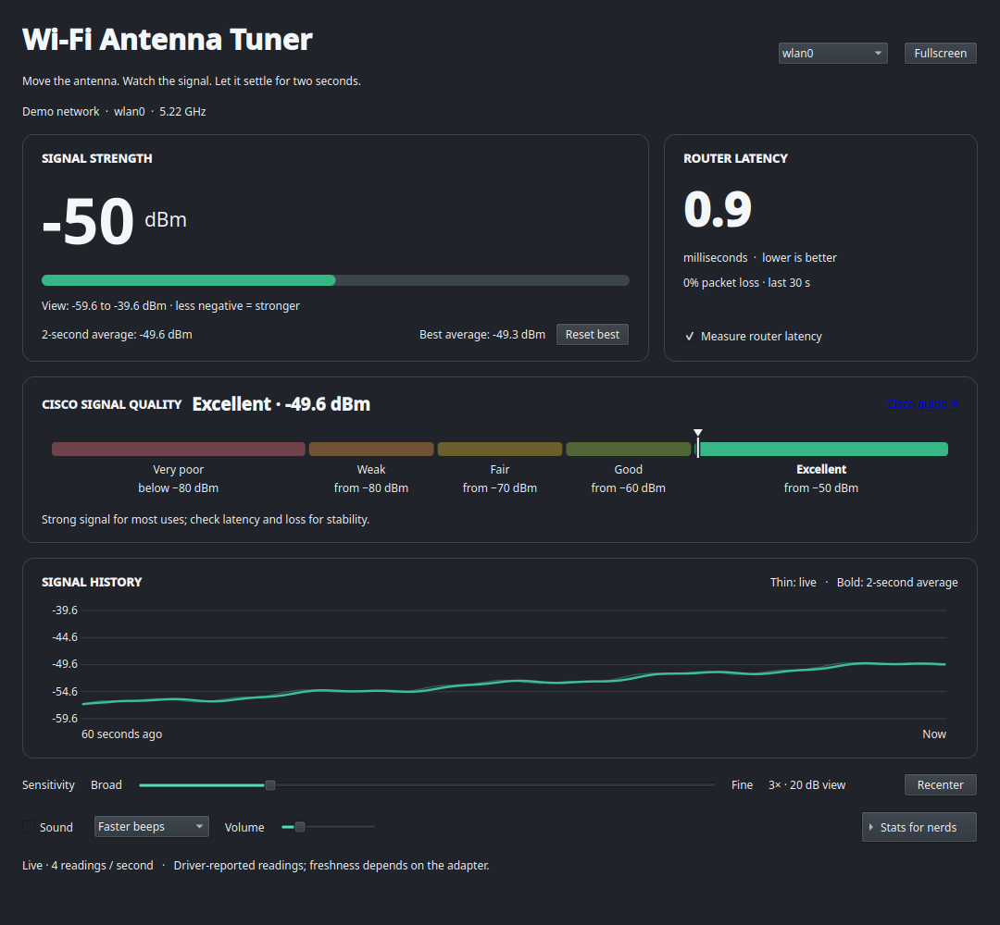

<div align="center">
  
  <h1>Wi-Fi Antenna Tuner</h1>
  <p>Find a better position for your PC's Wi-Fi antenna. Move it, watch the live signal, and keep the spot that stays strongest.</p>
  <p><strong>Linux · Bazzite · KDE · PySide6</strong></p>
  <p><a href="https://github.com/Mordeton/wifi-antenna-tuner/releases/latest">Latest release</a> · <a href="#install">Install</a> · <a href="#use-it">Use it</a> · <a href="#safety-and-privacy">Safety and privacy</a></p>
</div>



*Illustrative screenshot with generated readings and a demo network. No home network details are included.*

## What you get

- **Live signal:** a large dBm reading refreshed every 250 ms, plus a 60-second history graph.
- **A fair comparison:** a trailing two-second average and the best settled average from this session. Reset it when trying a new position.
- **An easy rating:** five Cisco signal-quality levels on a fixed scale, independent of the sensitivity setting.
- **A second check:** router latency, 30-second packet loss, and jitter from small probes through the selected Wi-Fi adapter. Probing can be switched off.
- **Eyes-free feedback:** optional faster beeps, continuous pitch, or both. Sound starts muted and has its own volume slider.
- **Deeper details:** per-chain signal, link rates, actual traffic, retries, failures, and connection information in an expandable panel. F11 switches to fullscreen.

The app reads Wi-Fi statistics and does not change network settings. Signal history stays in memory and disappears when you close it.

## Install

**Bazzite:** download the [latest release archive](https://github.com/Mordeton/wifi-antenna-tuner/releases/latest) while signed into an account with access to this private repository. Extract it, open a terminal in the extracted `wifi-antenna-tuner` folder, and run:

```sh
bash install.sh
```

If you use GitHub CLI, you can install from a clone instead:

```sh
gh repo clone Mordeton/wifi-antenna-tuner
cd wifi-antenna-tuner
bash install.sh
```

The installer asks separately about two shortcuts:

| Shortcut | Default | What it does |
| --- | --- | --- |
| Searchable application launcher | **Yes** | Adds “Wi-Fi Antenna Tuner” to the KDE app menu and KRunner. Search for `wifi` or `antenna`. |
| Desktop shortcut | **No** | Adds an icon to your Desktop folder. |

To pin the app to the taskbar, launch it and use **Pin to Task Manager** from its taskbar icon's context menu. Installation is per-user: no `sudo`, OS package layering, or reboot. The app is copied to `~/.local/share/wifi-antenna-tuner/` by default, so you can remove the downloaded archive afterward.

**Requirements:** Linux, Python 3.10+, Python virtual-environment support, `iw`, NetworkManager's `nmcli`, and `ping`. The installer reuses compatible system PySide6 when present or installs it into the app's private environment. Bazzite's native tools were verified on the target PC. Other distributions may need `python3-venv`, Qt desktop/audio libraries, and a compatible PySide6 wheel. Dependency downloads require internet access.

<details>
<summary>Installer flags and custom locations</summary>

```sh
bash install.sh --yes                    # Defaults without prompts: launcher yes, desktop no
bash install.sh --menu --desktop         # Both shortcuts, without prompts
bash install.sh --no-menu --no-desktop   # No shortcuts
bash install.sh --prefix /path/to/app --applications-dir /path/to/applications --desktop-dir /path/to/Desktop
```

The installer uses `$XDG_DATA_HOME` in place of `~/.local/share` when it is set.

</details>

## Use it

1. Move or rotate the antenna while watching the large **Signal strength** number. Less negative is stronger: **−49 dBm is stronger than −60 dBm**.
2. Leave it in each position for at least **two seconds**. Compare the **two-second average** and history graph; **Best average** remembers the strongest settled position until you reset it or the connection changes.
3. Check **Router latency** and loss for stability. A router that blocks ICMP may show no replies even while signal readings continue.
4. Set **Sensitivity** to suit the movement: 1× shows a broad 60 dB view; 3× is the default; 10× zooms to 6 dB. **Recenter** locks that view around the current reading. The raw dBm number and Cisco rating never change with sensitivity.
5. Turn on **Sound** if you want to listen while moving the antenna. Pick **Faster beeps**, **Continuous pitch**, or **Pitch + beeps**. Higher signal makes beeps faster or pitch higher. Sound stops when measurements go stale or the adapter disconnects.

The **Stats for nerds** panel stays expanded while readings update. Use **F11** for fullscreen and **Escape** to leave it.

## Signal-quality scale

The fixed meter follows [Cisco's IW9167E RSSI guidance](https://www.cisco.com/c/en/us/td/docs/IIOT/wireless/iw9167e/software/config/262x/iw9167-scg-262x/g_manage-the-workgroup-bridges-through-web-ui_wgb/t_modify-rssi-threshold.html):

| Rating | Reading |
| --- | --- |
| Excellent | −50 dBm or stronger |
| Good | −60 to below −50 dBm |
| Fair | −70 to below −60 dBm |
| Weak | −80 to below −70 dBm |
| Very poor | Below −80 dBm |

Cisco's ranges share endpoints; this app assigns an exact boundary to the stronger band. The pointer spans −100 to −30 dBm; the numerical reading is never clipped. Signal strength alone cannot show interference or guarantee a particular speed, so use router latency and loss alongside it.

## Update or remove

For a cloned checkout, update and run the installer again:

```sh
git pull --ff-only
bash install.sh
```

For an archive, download and extract the newer release, then run its installer. An upgrade backs up the previous installation and restores it if installation fails. Existing same-name shortcut files are backed up; user-edited shortcuts are preserved during removal.

To remove the default installation, close the app and run:

```sh
~/.local/share/wifi-antenna-tuner/uninstall.sh
```

The uninstaller asks for confirmation; `--yes` skips the prompt. A custom installation has its own `uninstall.sh`. If an OS update replaces Python or Qt and the app stops launching, rerun the installer from a current checkout or release archive to rebuild its environment.

## Safety and privacy

The app runs `iw` and `nmcli` to read connection data. It runs `ping` only against a literal unicast gateway reported by NetworkManager and bound to the selected Wi-Fi interface. It never scans for other networks, changes transmit power, reconnects Wi-Fi, or runs an internet speed test. Router probes are enabled by default and can be disabled in the app. No measurements are saved or uploaded.

The installer refuses root execution, overlapping source/install paths, symlinks in copied source files, damaged installation records, and missing original-shortcut backups. It replaces shortcuts atomically to avoid altering files that share an existing hard link. On a failed upgrade it tries to restore the old installation and reports any incomplete rollback.

The private repository has [GitHub dependency alerts](https://github.com/Mordeton/wifi-antenna-tuner/security/dependabot) enabled. Its CI job has read-only repository permission and does not retain checkout credentials. Install from the authenticated repository or its release page.

<details>
<summary>Measurement details and limits</summary>

- The app polls `iw` every 250 ms, but the driver may repeat the same radio sample. RX inactivity and sample age in the details panel help show freshness. Missing or stale data is marked unavailable.
- The graph keeps 60 seconds of signal values and a trailing two-second arithmetic average of dBm readings. Best signal requires two seconds of continuous valid samples. Changing adapter, access point, or frequency resets comparison history and counter baselines.
- Link rates are negotiated radio rates. Measured traffic uses changes in adapter byte counters and is not an internet speed test. Counter decreases reset the affected baseline.
- Per-chain numbers are driver identifiers, not labels for particular external antenna elements. Some drivers omit these or other statistics.
- Router probes run four times per second with a one-second reply deadline. The 30-second loss calculation excludes pending probes; RTT variation is the population standard deviation of replies. A delayed result never replaces a newer probe's result.

</details>

## Development

Run the tests on Linux with PySide6 available:

```sh
QT_QPA_PLATFORM=offscreen python3 -m unittest discover -s tests -v
```

Parsing and calculations are separate from the Qt interface. The test suite covers malformed and missing adapter output, connection changes, averaging, probe timing, audio behavior, installer rollback, and shortcut safety. [GitHub Actions](https://github.com/Mordeton/wifi-antenna-tuner/actions) runs the suite on Python 3.12 and 3.14. For development, run `./launch.sh` from the source checkout; installation is optional.
